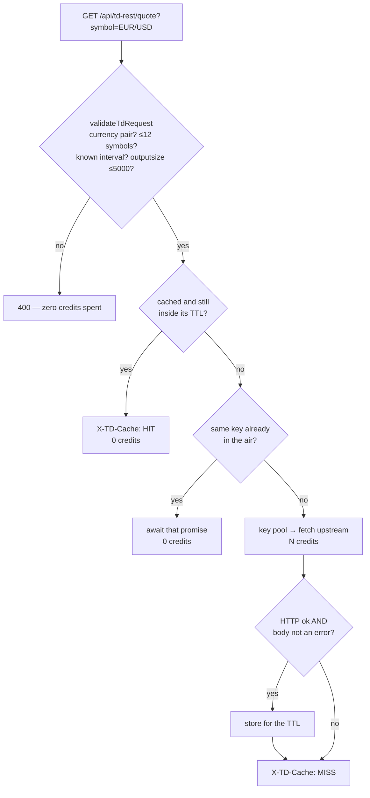
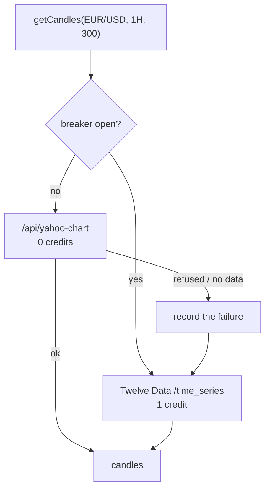
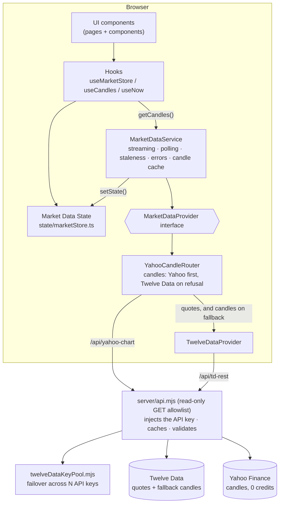
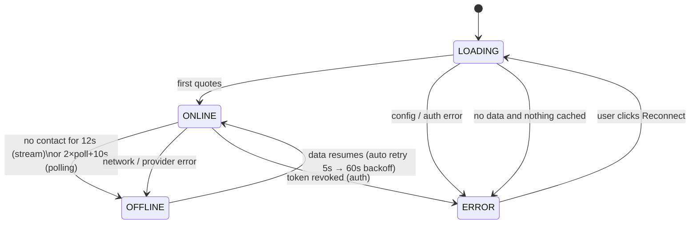
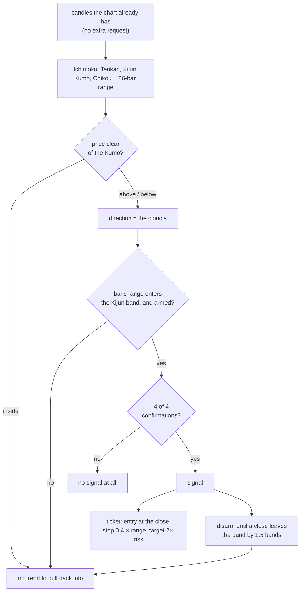
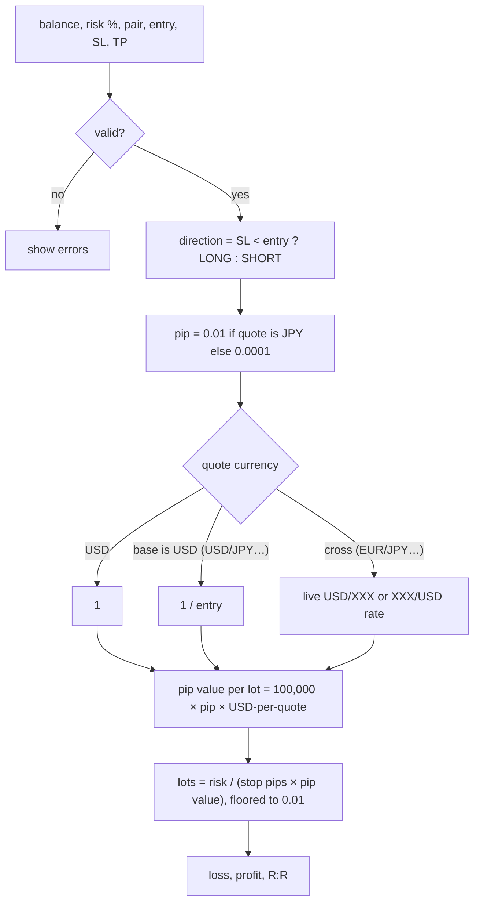
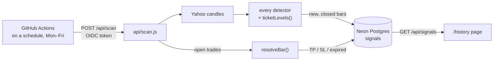

# Ichialgo — Forex terminal

**Live Forex market data, charts, three pure-Ichimoku strategies and a position-size calculator.**

> **The strategy runs in the browser.** A signal is a pure function of the candles on screen, so
> what the chart shows and what the engine decided cannot disagree — and the server-side scanner
> that records history runs the *same compiled module*. [§4](#4-strategy) covers the rules, what
> they measure, and why three earlier strategies were removed.

| Stack | |
|---|---|
| UI | React 19 + TypeScript, React Router 7 |
| Charts | TradingView Lightweight Charts v5 (open-source charting library) |
| Build | Vite 8 |
| Server | `server/api.mjs` read-only market-data proxy (used by dev, preview and `npm start`), with Twelve Data multi-key failover |
| Strategies | Three, selectable: our gated Kijun pullback, plus OANDA's published Tenkan/Kijun pullback and Kumo breakout, implemented to the letter and measured side by side. No EMA, no ATR in any of them. See [§4](#4-strategy) |
| Tests | Vitest — 425 across the strategy, the backtest, indicators, the proxy, the key pool, the response cache, the Yahoo candle route, the scanner, the database and the calculator |
| Data | Twelve Data, behind a provider interface |

---

## 1. Quick start

```bash
npm install
cp .env.example .env      # fill in ONE provider (see below)
npm run dev               # http://localhost:5173
npm test                  # calculator unit tests
npm run build             # typecheck + production bundle
npm start                 # production server: dist/ + proxy on http://127.0.0.1:8080
```

### Twelve Data keys

Twelve Data is the only provider. It is the one free forex source that serves intraday OHLC
candles **to a server, from any country, without a broker account** — OANDA is licensed per
country, Finnhub puts forex candles behind a paid plan, and Yahoo's unofficial endpoint blocks
datacenter IPs, so none of them work from a cloud host.

```
TWELVEDATA_API_KEY_1=key_from_account_1
TWELVEDATA_API_KEY_2=key_from_account_2
TWELVEDATA_API_KEY_3=key_from_account_3
TWELVEDATA_API_KEY_4=key_from_account_4
TWELVEDATA_API_KEY_5=key_from_account_5
```

One key per Twelve Data account; the numbering is the **failover order**. `TWELVEDATA_API_KEYS`
(comma-separated) and a single `TWELVEDATA_API_KEY` also work and can be mixed — see
`server/twelveDataKeyPool.mjs`.

#### The budget, and what more keys buy you

Free Basic is **8 credits/min and 800 credits/day PER KEY**, and `/quote` costs **1 credit per
symbol** — so a 7-pair refresh spends 7 credits. Chart candles come out of the same budget.

| Keys | Credits/min | Credits/day | Warm-up | Runtime/day at 60s polling |
|---|---|---|---|---|
| 1 | 8 | 800 | several minutes | ~1 h |
| 3 | 24 | 2400 | ~46 s | ~2.9 h |
| 5 | 40 | 4000 | ~46 s | **~4.8 h** |

Past ~3 keys the per-minute limit stops being the constraint and the **daily cap** becomes it.
More keys buy runtime, not speed. To trade speed for runtime, change one number:

| `VITE_TWELVEDATA_POLL_MS` | Credits/hour | 5 keys (4000/day) |
|---|---|---|
| `30000` (30 s) | ~1680 | ~2.4 h |
| `60000` (1 min, default) | ~840 | ~4.8 h |
| `120000` (2 min) | ~420 | ~9.5 h |
| `300000` (5 min) | ~168 | ~24 h |

(Quotes are 7 credits per refresh; candles cost roughly the same again.)

Check the pool any time at **`/api/td-rest/_status`** — key count, credits used today and each
key's state, with the keys masked to their last 4 characters.

> **Restart `npm run dev` after editing `.env`.** The keys have no `VITE_` prefix, so they stay in
> the Node proxy and are never bundled into browser code.

#### Background tabs do not spend credits

Polling suspends while the tab is hidden and takes one fresh reading when it comes back.

This matters more than it sounds. Seven pairs at the default 60-second interval spend ~420
credits an hour, so a single forgotten background tab exhausts a 4,000-credit daily budget in
under ten hours — and then every chart in the app fails on an exhausted key. The failure has no error of its own; it surfaces days later as "the data stopped working".

Streaming is deliberately left running: a websocket the provider is already pushing to costs
nothing per message, and tearing it down on every tab switch would trade a real reconnect for
an imaginary saving.

#### Repeat requests do not spend credits either

The proxy keeps successful responses in memory and serves repeats from there
(`server/responseCache.mjs`). A second tab, a reload, or two users on the same deployment asking
for the same quote in the same minute cost **one** credit between them, not one each.

| Shape | Default TTL | Env var | Why |
|---|---|---|---|
| `/quote` | 60 s | `TWELVEDATA_QUOTE_CACHE_MS` | prices move constantly |
| `/time_series` | 15 min | `TWELVEDATA_SERIES_CACHE_MS` | a 1h/4h bar only changes when it closes |

Set either to `0` to disable that half — useful for ten minutes of debugging, expensive to leave
off. Every response carries `X-TD-Cache: HIT|MISS`, so a credit question can be answered by
looking in devtools rather than guessing, and `/api/td-rest/_status` reports `cache.hits`,
`cache.misses` and `cache.entries`.

Two callers arriving together are the case a TTL alone does **not** cover: aligned pollers all
miss an empty cache in the same millisecond, so a plain TTL would let N tabs each start their own
upstream request. The cache therefore also does **single-flight** — the second caller joins the
request already in the air instead of starting a new one.



Errors are deliberately **not** cached. Caching one would turn a single bad minute into a whole
TTL of bad minutes, and an error is exactly what a caller should be free to retry.

Note the cache lives in the process, so on Vercel it is per warm instance and dies on a cold
start. That makes it weaker there than it is under `npm start`, not broken: the polling loop the
cache exists for hits the same warm instance repeatedly.

### Chart candles come from Yahoo, for free

A `/time_series` call costs a Twelve Data credit. Yahoo's chart endpoint costs
nothing and needs no account, so candles are taken from there first:



**Quotes stay on Twelve Data.** Yahoo was removed from this project once
already, for a real reason: the chart endpoint is unofficial and answers 429
to datacenter IPs, which is what a Vercel function is. Seven pairs polled
every 60 seconds forever from a serverless IP is exactly the traffic that
earns that refusal. Candles are a different shape of request — one per pair
per timeframe when a chart is opened, behind a 15-minute server cache — so
Yahoo is used as a **saving with a fallback, never as a dependency**.

The circuit breaker is what keeps a refusal cheap. Without it every chart
would pay a doomed round trip before falling back:

| What happened | What the breaker does |
|---|---|
| 429 (the datacenter-IP block) | park Yahoo for 30 min — it does not clear in a minute |
| any other failure, 1st or 2nd | nothing; one bad response is just one bad response |
| 3 failures in a row | park Yahoo for 5 min |
| a success | reset the count |

While parked, candles go straight to Twelve Data with no wasted request.

| Setting | Default | What it does |
|---|---|---|
| `VITE_YAHOO_CANDLES` | on | `0` goes back to Twelve Data for candles |
| `YAHOO_CACHE_MS` | `900000` | how long the proxy may reuse a Yahoo response |

Responses carry `X-Yahoo-Cache: HIT|MISS`, and `/api/td-rest/_status` reports
`yahooCache`. To see which source actually drew a chart, watch the network
tab: `/api/yahoo-chart` is free, `/api/td-rest/time_series` is a credit.

4H is the one timeframe Yahoo has no interval for, so it is **resampled from
1h bars** — exact, not approximate: four 1h bars tile a 4h bar perfectly.
They are bucketed on absolute UTC time (00:00, 04:00, 08:00…), which is not
necessarily where Twelve Data puts its own 4H bars, so a fallback refetches
the whole series rather than splicing two sources together.

### Security: the proxy is read-only
`server/api.mjs` forwards only an allowlist of **GET** endpoints (`quote`, `time_series`, and the
local `_status` report). Everything else gets `403`/`405`, and any non-GET method gets `405`.
Keeping it read-only and explicit means a bug here cannot turn the proxy into a general-purpose
relay, and your API keys never leave the server.
`npm start` binds to `127.0.0.1`. Don't expose it publicly without authentication in front.

Before any credit is committed, `server/tdValidate.mjs` also checks that the request is one we are
willing to **pay** for:

- the symbol is a currency pair — two ISO-4217 codes separated by `/` (a shape check, not a
  hard-coded list, so adding a pair to `src/config/pairs.ts` cannot silently break the proxy);
- at most 12 symbols per batch, because `/quote` charges per symbol;
- the interval is one Twelve Data actually supports;
- `outputsize` is a number and at most 5000.

A request that fails any of these gets `400` and costs **nothing**. Without this, anyone who found
the deployment could use it as their own free Twelve Data key — on your daily budget. The path
forwarded upstream is rebuilt from the validated parameters rather than patched, so nothing
unreviewed rides along.

### Why not TradingView for data?
TradingView does not offer a public market-data API for this. We use their **open-source chart library**
for rendering and a real Forex provider for data.

---

## 2. Architecture



Rules enforced by the structure:

- UI **never** imports a provider. It reads `marketStore` and calls `marketDataService`.
- Provider-specific code lives only in `services/marketData/providers/`.
- The factory `providers/index.ts` is the only file that knows concrete providers.

### Folder map

```
src/
  config/        pairs.ts (add pairs here), timeframes.ts, app.ts,
                 ichimokuStrategy.ts (the rules), strategy.ts (scan scheduling)
  services/marketData/
    types.ts                 provider contract, Quote, Candle, ProviderError
    http.ts                  fetch + timeout + HTTP→error mapping
    MarketDataService.ts     orchestration (the heart of the data layer)
    providers/               TwelveDataProvider, creditBudget, factory
    providers/yahooCandles   free candles: symbol/range mapping, 4H resampling
    providers/YahooCandleRouter  Yahoo first, Twelve Data on refusal (+breaker)
    index.ts                 singleton + public exports
  services/strategy/
    detectors.ts             the three strategies behind one interface — the seam
                             the engine, backtest and scanner all run through
    ichimokuBars.ts          the Ichimoku picture at one bar, shared by all three
                             so they cannot disagree about what a bar looked like
    ichimokuSignal.ts        OURS: Kumo direction, Kijun band, 4-of-4 gate, and
                             the live-quote path
    oandaPullback.ts         OANDA's Tenkan/Kijun trend continuation pullback
    oandaBreakout.ts         OANDA's Kumo breakout + their Chikou filter
    cloudZones.ts            OANDA's future support/resistance zones (no signals)
    signalTicket.ts          the shared exit — identical for every strategy, so
                             a comparison measures entries and not exits
    tradePlan.ts             rounds the detector's levels and sizes the position
    StrategyEngine.ts        scans pairs, watches quotes between scans
    chartMarkers.ts          signals → arrows, so the chart stays strategy-free
    backtest.ts              walk-forward replay: exits, pips, metrics, intervals
    serverEntry.ts           what esbuild bundles for the scanner — one implementation
    realData.test.ts         the detectors and the backtest over 30,000 real bars
  state/signalStore.ts       the signal log (useSyncExternalStore)
  state/marketStore.ts       immutable external store (useSyncExternalStore)
  state/accountStore.ts      balance + risk %, persisted; shared by plans and calculator
  hooks/                     useMarketData, useCandles, useChartIndicators, useNow
  lib/indicators/            ichimoku only — the EMA, ATR and swing-structure
                             modules went with the strategy that used them
  lib/                       positionSize (+tests), pips, format, time, locale
  hooks/useSignals.ts        strategy hooks: engine, log, per-pair level, ticket
  components/                Navbar, MetricCard, ForexTable, ForexRow, MarketStatus,
                             SignalTable, SignalBadge, ScoreTag, TradePlanCard, IchimokuPanel,
                             PriceChange, PairDetails, CandlestickChart, TimeframeSelector,
                             EmptyState, Calculator, ConnectionBanner, KumoMark
  components/chart/          kumoPrimitive (the Kumo fill)
  pages/                     Dashboard, PairPage, Backtest, History, CalculatorPage
db/migrations/               0001 the signals table, 0002 retires the EMA columns,
                             0003 makes it hold three strategies' different checks
fixtures/market/             real OANDA candles, for validating the strategy against
server/
  api.mjs                    read-only GET allowlist + Twelve Data key failover
  tdValidate.mjs             request guard: currency pairs only, batch + outputsize caps
  yahoo.mjs                  Yahoo chart allowlist (free candles, no account)
  responseCache.mjs          TTL cache + single-flight, so repeats cost no credits
  twelveDataKeyPool.mjs      multi-key credit pool (+ tests next to it)
  index.mjs                  production server (dist/ + the same proxy)
api/                         Vercel entry points wrapping server/api.mjs
```

---

## 3. How live data flows

```mermaid
sequenceDiagram
    participant App
    participant Svc as MarketDataService
    participant P as Provider
    participant S as marketStore
    participant UI as ForexRow (×7)

    App->>Svc: start()
    Svc->>S: status = LOADING
    Svc->>P: assertConfigured()
    alt missing / rejected credentials
        P-->>Svc: ProviderError(config | auth)
        Svc->>S: status = ERROR (halt until Reconnect)
    end
    Svc->>P: getQuotes(7 pairs)  (initial snapshot)
    P-->>Svc: { quotes, failed }
    Svc->>S: quotes, status = ONLINE
    S-->>UI: each row re-renders only for its own symbol
    else polling (Twelve Data)
        loop every pollIntervalMs
            Svc->>P: getQuotes()
        end
    end
```

### Connection state machine



**Stale data is never shown as live.** When status is not `ONLINE`, rows are dimmed and tagged
`STALE`, the header shows `● MARKET DATA OFFLINE`, and a banner explains why.
Weekend closures are different: the connection stays `ONLINE` and rows show `CLOSED`.

### Error handling matrix

| Error kind | Example | What the service does | What the user sees |
|---|---|---|---|
| `config` | proxy not running, bad account id | halt | red banner + fix instructions + Reconnect |
| `auth` | 401/403 | halt | "Twelve Data rejected the API key…" |
| `rate_limit` | 429 / Twelve Data credits | wait `Retry-After` (default 60s) | banner with countdown; OFFLINE if data ages out |
| `network` | timeout, stream stalled | exponential backoff 5s→60s, stream re-open 15s→5min | OFFLINE + STALE rows |
| `invalid_symbol` | pair not offered | drop that pair only | row tagged UNAVAILABLE |
| `no_data` | empty response | retry | ERROR/OFFLINE banner |

### Streaming (not used today)

`MarketDataService` can drive a push stream and fall back to polling when it dies, but Twelve
Data's WebSocket needs a Pro plan, so `capabilities.streaming` is `false` and the app polls.
The plumbing is kept because adding streaming later means implementing `subscribe()` on the
provider and nothing else.

### Candles

`useCandles(symbol, timeframe)` loads 300 candles, refreshes every `candleRefreshMs`
(≥120s on Twelve Data), and patches the **forming** candle's high/low/close with live ticks.
It never creates bars. `CandlestickChart` calls `series.update()` for small changes (keeps the user's zoom)
and `setData()` when the pair or timeframe changes.

**24H change**
Twelve Data's own `percent_change`, measured against the previous daily close — the column header
tooltip says so. There is no bid/ask on the REST quote, so those columns show `—`.

---

## 4. Strategies

**Pure Ichimoku, three ways.** The default is ours: price clear of the Kumo,
pulling back to Kijun-sen, with four Ichimoku confirmations as a gate. The
other two are OANDA's published rules, implemented to the letter so they can
be measured against it. No moving average, no ATR, no other indicator in any
of them — a test reads every strategy file and fails if one appears.

Pick one with the chips on the scanner or the backtest page; it lives in the
URL (`?s=oanda-breakout`), so a particular view is linkable and the pages
cannot disagree about which rules are live. The server-side scanner records
**all three on every pass**, so the history compares them on identical
candles rather than on whichever rule someone had selected.

The sections below describe OURS. OANDA's are further down.

It runs **in the browser**, off the candles the charts already hold. An
earlier design had a server-side scanner writing its opinion to Postgres while
the page computed another, and the two could disagree with nothing saying
which was right. The scanner that writes `/history` now runs the *same
compiled module* (`src/services/strategy/serverEntry.ts`).



### What decides what

| | |
|---|---|
| **Direction** | the Kumo. Above the cloud is a long, below is a short |
| **Trigger** | the bar's range entering a band around Kijun-sen |
| **Distance** | the 26-bar high-low range |
| **Gate** | four Ichimoku confirmations, all required |

The direction rule is the correction this strategy exists to make. The old one
took the side price *approached from*, so a pullback inside a downtrend became
a long. Here the cloud decides and nothing else can — asserted directly
against the recomputed cloud in `realData.test.ts`, not against the field the
detector wrote.

### Where the distance comes from, with no ATR

Removing the ATR leaves a strategy with no sense of distance: how wide is a
"touch", how far is a stop. Ichimoku already contains one, because **Kijun-sen
is the midpoint of the 26-bar high-low range**:

```
Kijun = (highest high + lowest low) / 2     over 26 bars
```

So `highest high − lowest low` over that same window is a volatility measure
that needs no new indicator and no new parameter. It is the Kijun's own width.
The touch band is `0.08 ×` it, and the stop is `0.4 ×` it.

### The gate

Four checks, each read in the direction the cloud set, so the same bar scores
differently for a long and a short:

1. the cloud **in effect** agrees (Senkou A vs B over this bar)
2. the cloud **26 bars ahead** agrees — known today, and what the trend walks into
3. **Chikou free** — the lagging line clear of the candles 26 bars back
4. **Tenkan** on the trade's side of Kijun

Below the threshold **no signal exists**. This is the other correction: the old
strategy logged every touch and annotated it with an Ichimoku score the rule
then ignored, with a dashboard filter offered as a consolation. A score that
decides nothing is a decoration.

One signal **per pullback, not per bar**: after one fires the pair is disarmed
until a close leaves the band by 1.5×. Without that, a market riding its Kijun
fires on every bar.

### Two ways a signal arrives

`analyseIchimoku` walks closed bars. `checkLiveTouch` takes the band the
newest bar left behind plus one quote, and fires the moment price reaches the
zone between scans — for no extra provider credits, since the quote stream is
already running. Both produce the same shape, score against the same gate, and
**share an id per bar**, so the closed bar's version replaces the live one
rather than adding a second row.

### The ticket

| | |
|---|---|
| Entry | the close of the pullback bar — where a market order fills |
| Stop | `0.4 × the 26-bar range` |
| Target | `2 ×` the stop distance |
| Size | from `lib/positionSize.ts` — the same tested math the calculator uses |

`tradePlan.ts` computes none of these. The detector puts them on the signal
and this layer only rounds them to prices a broker accepts and sizes the
position — so the ticket and the backtest cannot disagree about what was
risked. Rounding happens **before** sizing: sizing off a raw float once made
the plan quote 0.98 lots while the calculator it prefilled said 0.99, because
nobody can place an order at 1.1015183.

### Validated against real candles

`src/services/strategy/realData.test.ts` runs the detector over
`fixtures/market/` — 5000 real 1H OANDA bars per pair — and asserts what must
hold on any real series: it fires sometimes but nowhere near every bar, every
direction matches the cloud recomputed from the bar, every signal's bar
actually reached the Kijun band, nothing below the gate is emitted, and **it
reads no bar it could not have seen**.

That last one is the test everything else rests on. A strategy that peeks at
later bars prints an edge that does not exist, and nothing downstream can
detect it — the backtest, the metrics and the confidence interval are all
computed faithfully from a fiction.

### The backtest

`/backtest` replays the strategy over those same fixtures, through the same
detector and the same `ticketLevels()` the live trade-plan card shows.

| Rule | Why |
|---|---|
| **Entry is the signal bar's close** | A price that traded, by definition — so there is no fill rule and no no-fill count |
| **The trade is live from the next bar** | The fill is at the close, so that bar's high and low are both already past |
| **Same-bar ambiguity → the stop wins** | OHLC cannot order the two, and the alternative invents wins |
| **A trade still open at the end is not counted** | Assuming a result either way is how a losing run gets hidden |

The first rule is new, and it is the honest version rather than a kinder one.
Entry used to be a resting limit at the EMA, which meant deciding whether each
touch bar had actually reached the line: a third had not, and filling them
anyway was worth **+0.23R a trade across 1105 trades** of pure fiction (on
GBP/JPY the fillable trades totalled −9R while the unfillable ones "made"
+34R, with entries up to 4.8 pips better than the bar's own extreme). A market
order at the close cannot be flattered that way.

The signal count and the trade count are far apart, and the page says so:
**one position at a time**, so most signals are crowded out by a trade already
running. Across the five traded pairs, 1080 signals produce 369 trades.

Costs default to **1 pip**, charged against the price. The stop averages 31
pips, so the spread is about 3% of the bet.

### What it says, at 1 pip of cost

Five pairs, 5000 1H bars each, 3 Dec 2025 – 23 Sep 2026.

| Gate | Trades | Win | Average | 95% interval | PF |
|---|---|---|---|---|---|
| 1/4 | 619 | 34.6% | +0.33 pips | −3.88 … +4.54 | 1.02 |
| 2/4 | 603 | 35.0% | +1.15 pips | −3.15 … +5.45 | 1.05 |
| 3/4 | 543 | 35.4% | +1.43 pips | −3.17 … +6.02 | 1.07 |
| **4/4 (live)** | **369** | **36.9%** | **+3.89 pips** | **−1.63 … +9.40** | **1.20** |

**The interval spans zero at every setting, so none of this is a
profitability claim.** What the table shows is that the gate moves the number
in one direction, which is a property of the rule rather than of one slice.

Split by time it gets worse, not better:

| Period | Trades | Win | Average | 95% interval |
|---|---|---|---|---|
| First 60% | 236 | 35.2% | +0.66 pips | −5.80 … +7.12 |
| Last 40% | 127 | 40.9% | +10.68 pips | +0.16 … +21.19 |

Every variant tested — including rules with no edge at all — improves by a
similar amount across that boundary, so the second period was simply kinder
rather than the rule being validated out of sample. **The honest summary is
"around break-even on hard data, good on easy data".**

The gate's evidence is narrower than the first table suggests for the same
reason: on the hard first 60% it turns −4.00 into +0.66, but on the kind last
40% it is a wash and slightly negative (+11.26 at 2/4, +10.68 at 4/4). Four is
chosen for robustness in poor conditions, not for more upside in good ones.

And it is not uniform across pairs:

| Pair | Signals | Trades | Win | Average | Total |
|---|---|---|---|---|---|
| EUR/USD | 208 | 70 | 40.0% | +7.05 | +494 |
| GBP/USD | 178 | 74 | 36.5% | +2.06 | +153 |
| USD/JPY | 227 | 75 | 38.7% | +7.94 | +596 |
| AUD/USD | 235 | 78 | 25.6% | **−5.02** | **−391** |
| USD/CAD | 232 | 72 | 44.4% | +8.11 | +584 |

**What this does not prove**, stated on the page itself:

- **It does not cover every pair traded.** USD/CHF and NZD/USD are scanned
  live and have no checked-in candles.
- **The scanner runs 30M and every fixture is 1H.** Nothing here is settled
  for the timeframe actually traded.
- **One period.** Dec 2025 – Sep 2026 is nine months of one regime.
- **The pairs are correlated.** EUR/USD, GBP/USD and AUD/USD are largely the
  same dollar trade, so 369 trades are worth fewer than 369 independent
  observations and the interval is narrower than it should be.
- **It is all in-sample.** Every setting was chosen after seeing these candles.
- **Costs are a flat estimate.** Real spreads widen at the open and on news,
  exactly when Kijun tends to get retested. Swap is not modelled.

### OANDA's published rules, implemented alongside

Two of the three strategies are not ours. They are the entry rules from
OANDA's *Ichimoku Cloud trading guide: key strategies*, implemented to the
letter and measured on the same candles through the same harness, so the
comparison is of ENTRIES and nothing else.

The article names four approaches. Three are entry rules; the fourth is a way
of reading the chart and produces no signals, so it is a read-out on the pair
page rather than a detector.

| OANDA's rule | Where it lives |
|---|---|
| **Kumo breakout** | `oandaBreakout.ts` — a detector |
| **Tenkan/Kijun trend continuation pullback** | `oandaPullback.ts` — a detector |
| **Chikou span confirmation filter** | inside `oandaBreakout.ts`, which is where their article attaches it |
| **Future support and resistance zones** | `cloudZones.ts` — a read-out, no signals |

**Tenkan/Kijun trend continuation pullback**, quoted:

> Price above the Cloud (green coloured).
> - Tenkan-sen (Conversion line) is above Kijun-sen (Base line).
> - Pullback touches or dips slightly below Tenkan-sen (Conversion line) or Kijun-sen (Base line).
> - Price closes above Kijun-sen (Base line) with a bullish candlestick.

Note what is **absent**: the cloud's colour, the forward cloud and Chikou. All
three gate our strategy and none of them is in theirs. The pullback and the
confirming close are also different events on different bars — in the
article's USD/JPY example the dip is in the morning and the confirming hourly
close at 1pm — so this is a state machine, not a single-bar test.

**Kumo breakout**, quoted: *"Price breaks above the cloud. Cloud is turning
bullish (Span A crossing above span B)."* The twist is allowed to arrive after
the break, because in both of the article's own examples it did — three hours
later on AUD/USD, twenty-six on NZD/USD. Requiring both on one bar would
reject their own illustrations.

**Chikou** is compared with *"its prior 26-period price"* — that bar's close.
Ours uses the stricter test of clearing that bar's whole range. They are not
the same rule, so each strategy keeps its own.

### What the article does not give you

**No stop, no target, no position size — not one sentence.** So the exit is
ours, and it is deliberately identical for all three: comparing two entry
rules is only meaningful when the exit is held constant, or the comparison
quietly measures the exits instead.

The article also closes by suggesting the Cloud be paired with RSI or
Stochastic. That is not implemented: it contradicts the pure-Ichimoku rule,
and the purity test covers every strategy file, so it would fail the build.

### All three, measured on the same candles

Five traded pairs, 5000 1H bars each, 3 Dec 2025 – 23 Sep 2026, one pip of
cost, identical exits.

| Strategy | Signals | Trades | Win | Average | 95% interval | PF |
|---|---|---|---|---|---|---|
| **Kijun pullback (ours)** | 1080 | 369 | 36.9% | **+3.89 pips** | −1.63 … +9.40 | 1.20 |
| Tenkan/Kijun pullback (OANDA) | 3138 | 515 | 35.1% | −0.99 pips | −6.10 … +4.13 | 0.96 |
| Kumo breakout (OANDA) | 831 | 466 | 33.3% | **−3.47 pips** | −7.58 … +0.64 | 0.84 |

Every interval spans zero, so none of these is a profitability claim — but
the ordering is consistent, and that is the part worth having. Split by time:

| Strategy | First 60% (hard) | Last 40% (kind) |
|---|---|---|
| Kijun pullback (ours) | +0.66 | +10.68 |
| Tenkan/Kijun pullback | −3.85 | +6.21 |
| Kumo breakout | −5.08 | −0.94 |

The kind period lifts all three, which is why a single split proves nothing
about any of them. What survives the split is the **ranking**: ours above
their pullback above their breakout, in both halves. That is a stronger
statement than any one average, because the thing that flatters a period
flatters all three equally.

The breakout loses on four pairs of five and loses badly on GBP/USD
(−10.02 pips over 103 trades). It is also the entry shape that lost before:
the TK cross measured on these same fixtures came in at −2.74 pips over 889
trades, worse the more Ichimoku agreed. Both are momentum entries taken after
the move has happened.

**None of this says OANDA's rules are bad.** It says that on 1H majors, over
nine months, with this exit, in a harness where the only variable is the
entry, they did worse than what was already here. The article is explicit that
the Cloud "performs poorly in tight, choppy, or scalping conditions", and
hourly FX majors spend a lot of time exactly there.

### The strategies that are not here, and why

**EMA50 touch** came first: a band around a 50-period EMA sized by ATR, with
Ichimoku bolted on as a five-check annotation. Measured on these same
fixtures, the touch alone was worth **−0.13 pips a trade at a 35.7% win rate
against the 36.0% it needed to break even** — nothing. All of the edge lived
in the Ichimoku score the rule did not act on, which is what this strategy is.
Its database rows are still on disk (see `db/migrations/0002_ichimoku.sql`);
its code is not.

**A TK cross** (Tenkan crossing Kijun) was built and measured as the
alternative Ichimoku trigger. It loses, and loses *more* with more
confirmation — the signature of an entry that is simply late. Removed.

**A multi-timeframe confluence engine** — market structure, S/R, chart
patterns, 21 candlestick patterns — was built earlier and removed. It and the
EMA strategy were both validated against a synthetic market generator written
alongside them, and that generator injected trends 45% of the time, which
flatters a trend-following strategy by construction. It reported +0.39R a
trade in "trending" conditions, clean parameter sweeps, a tidy knee in the
tuning curve. On real OANDA data:

```
172 trades      −0.097R per trade
win rate 30.8%  (34.1% needed at the observed 1.93:1 payoff)
95% CI          −0.308R to +0.113R      ← spans zero
```

**The lesson worth keeping:** a generated market can establish that an engine
is *causal* (it does not read future bars), that its *tickets are coherent*
(stop the right side of entry, reward/risk as claimed), and that it *does not
throw*. Those are real and worth testing. It cannot establish that a rule
works. Using it for that produced three rounds of tuning against noise, and
every number reported along the way was wrong in the same direction.

## 5. Position-size calculator

Pure functions in `src/lib/positionSize.ts`, tested in `positionSize.test.ts`. Account currency is USD.



Worked example (unit test): USD/JPY at 150.00, stop 150.50, $10,000, 1% risk
→ 50 pips, pip value $6.67/lot, **0.30 lots**.

---

## 6. Signal history

The strategy runs in the browser, which means it only runs while a tab is
open. A history assembled that way records when somebody was looking at the
site, not what the market did — an earlier version of this project threw away
421 rows for exactly that reason. So the history is written by a server-side
scanner and the browser only reads it.



**One strategy, two runtimes.** The scanner does not re-implement anything.
`scripts/bundle-strategy.mjs` compiles `src/services/strategy/serverEntry.ts`
to `server/strategy.bundle.mjs` during the build, so the server executes the
same functions the browser does — including `resolveBar`, which is the
backtest's own take-profit/stop rule. `server/scanner.test.mjs` replays a
fixture through both and requires the same verdict on every trade.

It applies the backtest's pessimistic rules, for the same reason:

1. **Entry is the signal bar's close** — a price that traded by definition, so
   there is no fill rule and no `nofill` outcome. The previous strategy rested
   a limit at the EMA and had to turn away about a third of its touches.
2. **The trade is live from the next bar.** The fill is at the close, so
   nothing that bar did can decide the trade in either direction.
3. **Same-bar ambiguity goes to the stop.**

Every strategy is recorded on every pass, on the same candles, so the history
can compare them rather than describe whichever rule a browser happened to
have selected. Signal ids are namespaced by strategy, so three rules firing on
one bar are three rows and never a collision.

Because the three have different conditions, the checks are stored as the list
each detector produced rather than as named columns — see
`db/migrations/0003_strategies.sql` for why a union of booleans could not
work. The table also still holds rows from the retired EMA strategy: they are
real observations, so `0002_ichimoku.sql` dropped its indicator columns and
kept the rows. Every read filters by `strategy`, so none of them are mixed
into one total; `server/db.test.mjs` pins that, including the upgrade applied
to a table that already has rows in it.

Results are stored in **pips**, raw — no spread. The backtest charges a spread
because it asks whether the strategy would have made money; this table records
what price did.

### Authentication needs no setup

The workflow proves who it is with a **GitHub OIDC token** minted for that
run — `permissions: id-token: write` and nothing else. `/api/scan` verifies it
against GitHub's public keys and checks the issuer, the audience, the expiry
and, crucially, that the `repository` claim is this one. Every public repo on
GitHub can get a valid token from the same issuer; the repository check is
what makes the endpoint ours.

There is no shared secret to create, paste into two places, keep in step or
rotate, and a token copied out of a log expires in minutes. `SCANNER_TOKEN`
still works if one is configured, for driving the endpoint from something
that is not GitHub Actions.

The endpoint is **closed by default**: with neither a secret nor a known
repository configured, every request is refused rather than allowed.
`server/scanAuth.test.mjs` and `server/githubOidc.test.mjs` pin that, along
with `alg: none`, algorithm confusion, a wrong signing key, a tampered
payload, a token for another repository and one for another audience.

### Why GitHub Actions and not a Vercel cron

Vercel's Hobby plan runs a cron job **once a day, accurate to the hour**. The
strategy is evaluated on 30-minute bars, so that is useless. GitHub Actions
schedules are free and unlimited on a public repository and go down to five
minutes (`.github/workflows/scan.yml`).

Nothing depends on the trigger being punctual. Every run re-reads the last
`SCAN_LOOKBACK_BARS` closed bars (four by default — two hours on 30M), and the
signal id is deterministic (`strategy|symbol|timeframe|barTime`) with
`ON CONFLICT DO NOTHING`, so a late run catches up and a repeated run writes
nothing twice.

### Setting it up

1. **Vercel → Storage → Neon.** The integration is a Marketplace product;
   creating the database adds `DATABASE_URL` to the project automatically.
2. **Nothing.** Authentication is handled by the OIDC token above, and the
   allowed repository comes from `VERCEL_GIT_REPO_OWNER`/`_SLUG`, which Vercel
   sets on every deployment from a connected repository.
3. **Deploy.** `npm run build` ends with `npm run migrate`, which applies
   `db/migrations/*.sql`. With no `DATABASE_URL` it skips and the build still
   succeeds — the history is an addition to the app, not a prerequisite. Once
   there IS a database, a failed migration fails the build, because deploying
   an app whose queries name missing columns is worse.

Until the database is attached, `/history` says so and explains what is
missing.

### Local development

`DATABASE_URL` pointing anywhere other than `*.neon.tech` falls back to
`pg` (a devDependency) instead of Neon's HTTPS driver, so a local Postgres
works:

```bash
createdb ichialgo
DATABASE_URL=postgresql://localhost/ichialgo npm run migrate
DATABASE_URL=postgresql://localhost/ichialgo npm run dev
```

The database tests run against a real PostgreSQL server rather than a mock,
because the things that break — `jsonb_to_recordset` column lists, the
conflict target, `extract(epoch from …)` — only break in Postgres. They skip
themselves when `TEST_DATABASE_URL` is unset:

```bash
TEST_DATABASE_URL=postgresql://localhost/ichialgo npm test
```


## 7. Extending

**Add a pair:** append to `EXTRA_SYMBOLS` in `src/config/pairs.ts`. Nothing else changes.

**Add a provider:** the interface is still there, so the UI needs no changes.
1. Implement `MarketDataProvider` in `providers/MyProvider.ts` (map symbols, map errors to `ProviderError`).
2. Register it in `providers/index.ts` and add `'myprovider'` to `ProviderId`.
3. Add a read-only route for it in `server/api.mjs` (`routes` array).
4. **Create the serverless entry point** re-exporting `_lib/handler.mjs`, and get the SHAPE right:

   | The route your proxy serves | The file Vercel needs |
   |---|---|
   | `/api/<prefix>/something` | `api/<prefix>/[...path].js` |
   | `/api/<prefix>` (bare, params in the query) | `api/<prefix>.js` |

   A `[...path]` catch-all matches `/api/foo/bar` but **not** `/api/foo` — it needs at least one
   segment. Neither mistake fails locally, because Vite pipes every request through the shared
   middleware whatever is in `api/`. `server/api.routes.test.mjs` derives the required shape from
   the route regexes and fails if a route and its file disagree.


**Tune the strategy:** every threshold lives in `src/config/strategy.ts` — band width, re-arm
distance, stop multiple, R target, the Ichimoku agreement threshold. Measure any change against
`fixtures/market/` before trusting it — [§4](#4-strategy)
records what happens otherwise.

---

## 8. Production deployment

```bash
npm run build
npm start          # serves dist/ and the proxy; reads .env
```

`server/index.mjs` is a small Express server that uses the **same** proxy module as `npm run dev`.
Configure it with `PORT` and `HOST` in `.env`. Put HTTPS and authentication (nginx, Caddy, Cloudflare Access, a VPN) in front
before exposing it beyond your machine.

If you use your own reverse proxy instead, copy the **GET-only allowlist** from `server/api.mjs`.
Don't use a catch-all `/v3/` rule.

### Testing against a mock provider
`TWELVEDATA_REST_URL` overrides the upstream host, for local testing only. Point it at a mock
server that returns Twelve Data-shaped JSON to exercise LOADING, ONLINE, OFFLINE and ERROR states
offline — including credit exhaustion, which is otherwise awkward to reproduce on purpose.
