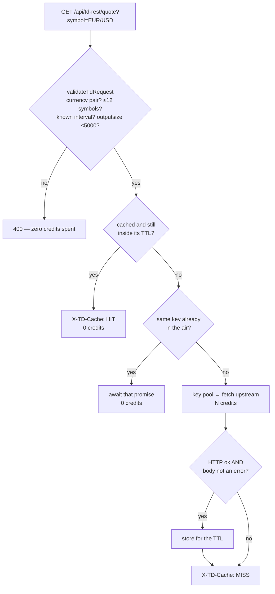
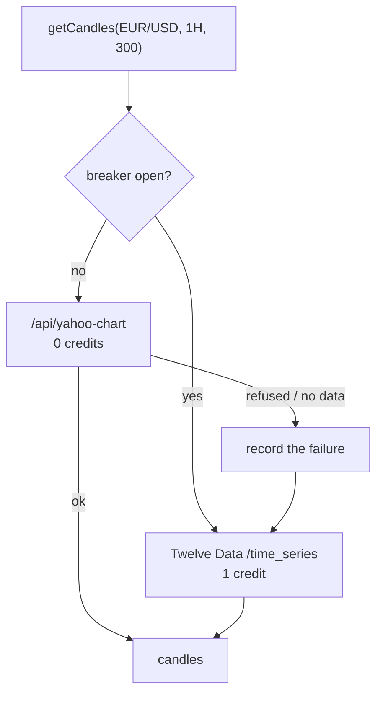
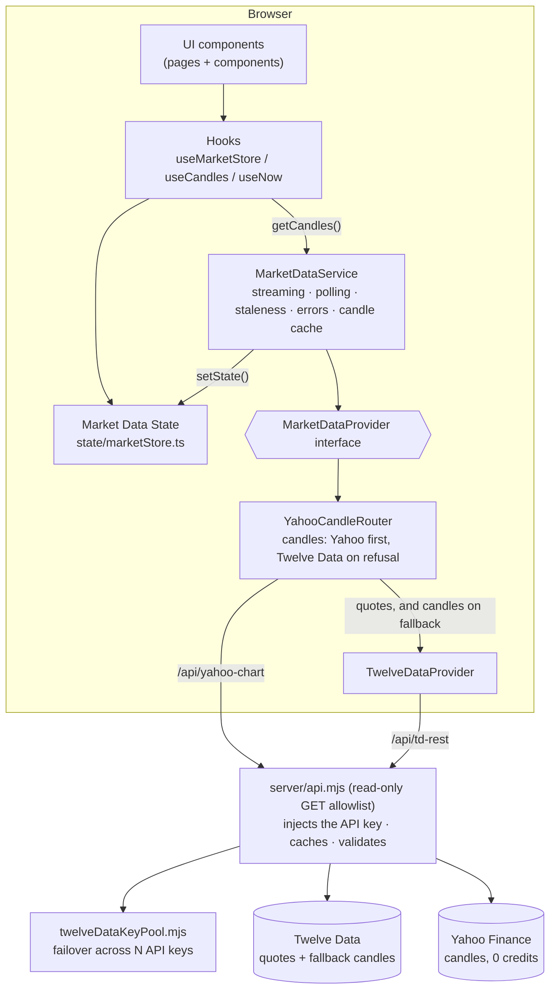
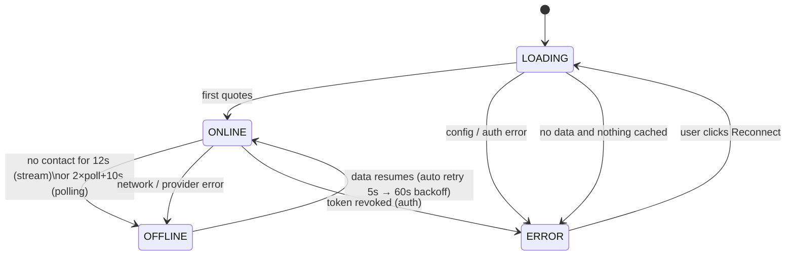
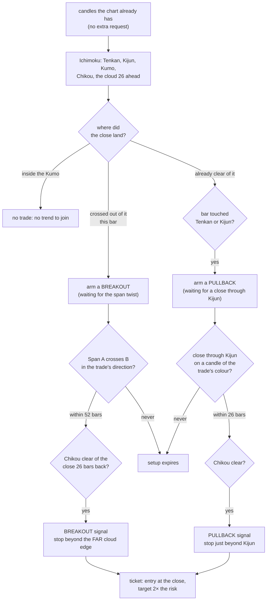
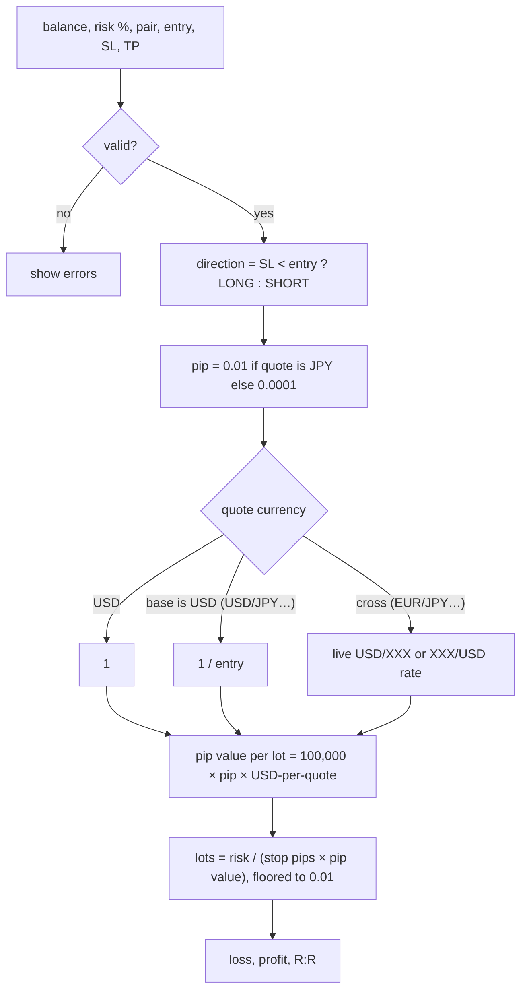
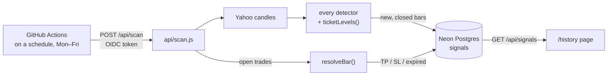

# Ichialgo — Forex terminal

**Live Forex market data, charts, three pure-Ichimoku strategies and a position-size calculator.**

> **The strategy runs in the browser.** A signal is a pure function of the candles on screen, so
> what the chart shows and what the engine decided cannot disagree — and the server-side scanner
> that records history runs the *same compiled module*. [§4](#4-strategy) covers the rules, what
> they measure, and why three earlier strategies were removed.

| Stack | |
|---|---|
| UI | React 19 + TypeScript, React Router 7 |
| Charts | TradingView Lightweight Charts v5 (open-source charting library) |
| Build | Vite 8 |
| Server | `server/api.mjs` read-only market-data proxy (used by dev, preview and `npm start`), with Twelve Data multi-key failover |
| Strategy | One: the Ichimoku system from OANDA's published guide — a Kumo breakout and a Tenkan/Kijun pullback, Chikou validating both, stops on Kijun and the cloud edge. No EMA, no ATR, no other indicator; a test fails the build if one appears. See [§4](#4-strategies) |
| Tests | Vitest — 425 across the strategy, the backtest, indicators, the proxy, the key pool, the response cache, the Yahoo candle route, the scanner, the database and the calculator |
| Data | Twelve Data, behind a provider interface |

---

## 1. Quick start

```bash
npm install
cp .env.example .env      # fill in ONE provider (see below)
npm run dev               # http://localhost:5173
npm test                  # calculator unit tests
npm run build             # typecheck + production bundle
npm start                 # production server: dist/ + proxy on http://127.0.0.1:8080
```

### Twelve Data keys

Twelve Data is the only provider. It is the one free forex source that serves intraday OHLC
candles **to a server, from any country, without a broker account** — OANDA is licensed per
country, Finnhub puts forex candles behind a paid plan, and Yahoo's unofficial endpoint blocks
datacenter IPs, so none of them work from a cloud host.

```
TWELVEDATA_API_KEY_1=key_from_account_1
TWELVEDATA_API_KEY_2=key_from_account_2
TWELVEDATA_API_KEY_3=key_from_account_3
TWELVEDATA_API_KEY_4=key_from_account_4
TWELVEDATA_API_KEY_5=key_from_account_5
```

One key per Twelve Data account; the numbering is the **failover order**. `TWELVEDATA_API_KEYS`
(comma-separated) and a single `TWELVEDATA_API_KEY` also work and can be mixed — see
`server/twelveDataKeyPool.mjs`.

#### The budget, and what more keys buy you

Free Basic is **8 credits/min and 800 credits/day PER KEY**, and `/quote` costs **1 credit per
symbol** — so a 7-pair refresh spends 7 credits. Chart candles come out of the same budget.

| Keys | Credits/min | Credits/day | Warm-up | Runtime/day at 60s polling |
|---|---|---|---|---|
| 1 | 8 | 800 | several minutes | ~1 h |
| 3 | 24 | 2400 | ~46 s | ~2.9 h |
| 5 | 40 | 4000 | ~46 s | **~4.8 h** |

Past ~3 keys the per-minute limit stops being the constraint and the **daily cap** becomes it.
More keys buy runtime, not speed. To trade speed for runtime, change one number:

| `VITE_TWELVEDATA_POLL_MS` | Credits/hour | 5 keys (4000/day) |
|---|---|---|
| `30000` (30 s) | ~1680 | ~2.4 h |
| `60000` (1 min, default) | ~840 | ~4.8 h |
| `120000` (2 min) | ~420 | ~9.5 h |
| `300000` (5 min) | ~168 | ~24 h |

(Quotes are 7 credits per refresh; candles cost roughly the same again.)

Check the pool any time at **`/api/td-rest/_status`** — key count, credits used today and each
key's state, with the keys masked to their last 4 characters.

> **Restart `npm run dev` after editing `.env`.** The keys have no `VITE_` prefix, so they stay in
> the Node proxy and are never bundled into browser code.

#### Background tabs do not spend credits

Polling suspends while the tab is hidden and takes one fresh reading when it comes back.

This matters more than it sounds. Seven pairs at the default 60-second interval spend ~420
credits an hour, so a single forgotten background tab exhausts a 4,000-credit daily budget in
under ten hours — and then every chart in the app fails on an exhausted key. The failure has no error of its own; it surfaces days later as "the data stopped working".

Streaming is deliberately left running: a websocket the provider is already pushing to costs
nothing per message, and tearing it down on every tab switch would trade a real reconnect for
an imaginary saving.

#### Repeat requests do not spend credits either

The proxy keeps successful responses in memory and serves repeats from there
(`server/responseCache.mjs`). A second tab, a reload, or two users on the same deployment asking
for the same quote in the same minute cost **one** credit between them, not one each.

| Shape | Default TTL | Env var | Why |
|---|---|---|---|
| `/quote` | 60 s | `TWELVEDATA_QUOTE_CACHE_MS` | prices move constantly |
| `/time_series` | 15 min | `TWELVEDATA_SERIES_CACHE_MS` | a 1h/4h bar only changes when it closes |

Set either to `0` to disable that half — useful for ten minutes of debugging, expensive to leave
off. Every response carries `X-TD-Cache: HIT|MISS`, so a credit question can be answered by
looking in devtools rather than guessing, and `/api/td-rest/_status` reports `cache.hits`,
`cache.misses` and `cache.entries`.

Two callers arriving together are the case a TTL alone does **not** cover: aligned pollers all
miss an empty cache in the same millisecond, so a plain TTL would let N tabs each start their own
upstream request. The cache therefore also does **single-flight** — the second caller joins the
request already in the air instead of starting a new one.



Errors are deliberately **not** cached. Caching one would turn a single bad minute into a whole
TTL of bad minutes, and an error is exactly what a caller should be free to retry.

Note the cache lives in the process, so on Vercel it is per warm instance and dies on a cold
start. That makes it weaker there than it is under `npm start`, not broken: the polling loop the
cache exists for hits the same warm instance repeatedly.

### Chart candles come from Yahoo, for free

A `/time_series` call costs a Twelve Data credit. Yahoo's chart endpoint costs
nothing and needs no account, so candles are taken from there first:



**Quotes stay on Twelve Data.** Yahoo was removed from this project once
already, for a real reason: the chart endpoint is unofficial and answers 429
to datacenter IPs, which is what a Vercel function is. Seven pairs polled
every 60 seconds forever from a serverless IP is exactly the traffic that
earns that refusal. Candles are a different shape of request — one per pair
per timeframe when a chart is opened, behind a 15-minute server cache — so
Yahoo is used as a **saving with a fallback, never as a dependency**.

The circuit breaker is what keeps a refusal cheap. Without it every chart
would pay a doomed round trip before falling back:

| What happened | What the breaker does |
|---|---|
| 429 (the datacenter-IP block) | park Yahoo for 30 min — it does not clear in a minute |
| any other failure, 1st or 2nd | nothing; one bad response is just one bad response |
| 3 failures in a row | park Yahoo for 5 min |
| a success | reset the count |

While parked, candles go straight to Twelve Data with no wasted request.

| Setting | Default | What it does |
|---|---|---|
| `VITE_YAHOO_CANDLES` | on | `0` goes back to Twelve Data for candles |
| `YAHOO_CACHE_MS` | `900000` | how long the proxy may reuse a Yahoo response |

Responses carry `X-Yahoo-Cache: HIT|MISS`, and `/api/td-rest/_status` reports
`yahooCache`. To see which source actually drew a chart, watch the network
tab: `/api/yahoo-chart` is free, `/api/td-rest/time_series` is a credit.

4H is the one timeframe Yahoo has no interval for, so it is **resampled from
1h bars** — exact, not approximate: four 1h bars tile a 4h bar perfectly.
They are bucketed on absolute UTC time (00:00, 04:00, 08:00…), which is not
necessarily where Twelve Data puts its own 4H bars, so a fallback refetches
the whole series rather than splicing two sources together.

### Security: the proxy is read-only
`server/api.mjs` forwards only an allowlist of **GET** endpoints (`quote`, `time_series`, and the
local `_status` report). Everything else gets `403`/`405`, and any non-GET method gets `405`.
Keeping it read-only and explicit means a bug here cannot turn the proxy into a general-purpose
relay, and your API keys never leave the server.
`npm start` binds to `127.0.0.1`. Don't expose it publicly without authentication in front.

Before any credit is committed, `server/tdValidate.mjs` also checks that the request is one we are
willing to **pay** for:

- the symbol is a currency pair — two ISO-4217 codes separated by `/` (a shape check, not a
  hard-coded list, so adding a pair to `src/config/pairs.ts` cannot silently break the proxy);
- at most 12 symbols per batch, because `/quote` charges per symbol;
- the interval is one Twelve Data actually supports;
- `outputsize` is a number and at most 5000.

A request that fails any of these gets `400` and costs **nothing**. Without this, anyone who found
the deployment could use it as their own free Twelve Data key — on your daily budget. The path
forwarded upstream is rebuilt from the validated parameters rather than patched, so nothing
unreviewed rides along.

### Why not TradingView for data?
TradingView does not offer a public market-data API for this. We use their **open-source chart library**
for rendering and a real Forex provider for data.

---

## 2. Architecture



Rules enforced by the structure:

- UI **never** imports a provider. It reads `marketStore` and calls `marketDataService`.
- Provider-specific code lives only in `services/marketData/providers/`.
- The factory `providers/index.ts` is the only file that knows concrete providers.

### Folder map

```
src/
  config/        pairs.ts (add pairs here), timeframes.ts, app.ts,
                 ichimokuStrategy.ts (the rules), strategy.ts (scan scheduling)
  services/marketData/
    types.ts                 provider contract, Quote, Candle, ProviderError
    http.ts                  fetch + timeout + HTTP→error mapping
    MarketDataService.ts     orchestration (the heart of the data layer)
    providers/               TwelveDataProvider, creditBudget, factory
    providers/yahooCandles   free candles: symbol/range mapping, 4H resampling
    providers/YahooCandleRouter  Yahoo first, Twelve Data on refusal (+breaker)
    index.ts                 singleton + public exports
  services/strategy/
    ichimokuSystem.ts        THE strategy: both entries, one pass, one state
                             machine per pair — breakout and pullback cannot stack
    ichimokuBars.ts          the Ichimoku picture at one bar, so both entries
                             cannot disagree about what a bar looked like
    cloudZones.ts            OANDA's future support/resistance zones (no signals)
    signalTicket.ts          the ticket: structural stop in, rounded levels out
    tradePlan.ts             rounds the detector's levels and sizes the position
    StrategyEngine.ts        scans pairs on bar boundaries (no live-quote path:
                             both entries need a CLOSE, which a tick cannot give)
    chartMarkers.ts          signals → arrows, so the chart stays strategy-free
    backtest.ts              walk-forward replay: exits, pips, metrics, intervals
    serverEntry.ts           what esbuild bundles for the scanner — one implementation
    ichimokuSystem.test.ts   the RULES, condition by condition, vs the article
    realData.test.ts         breadth + integration over 30,000 real bars
  state/signalStore.ts       the signal log (useSyncExternalStore)
  state/marketStore.ts       immutable external store (useSyncExternalStore)
  state/accountStore.ts      balance + risk %, persisted; shared by plans and calculator
  hooks/                     useMarketData, useCandles, useChartIndicators, useNow
  lib/indicators/            ichimoku only — the EMA, ATR and swing-structure
                             modules went with the strategy that used them
  lib/                       positionSize (+tests), pips, format, time, locale
  hooks/useSignals.ts        strategy hooks: engine, log, per-pair level, ticket
  components/                Navbar, MetricCard, ForexTable, ForexRow, MarketStatus,
                             SignalTable, SignalBadge, ScoreTag, TradePlanCard, IchimokuPanel,
                             PriceChange, PairDetails, CandlestickChart, TimeframeSelector,
                             EmptyState, Calculator, ConnectionBanner, KumoMark
  components/chart/          kumoPrimitive (the Kumo fill)
  pages/                     Dashboard, PairPage, Backtest, History, CalculatorPage
db/migrations/               0001 the signals table, 0002 retires the EMA columns,
                             0003 stores each signal's own checks as jsonb,
                             0004 adds entry_type and keeps retired rows separate
fixtures/market/             real OANDA candles, for validating the strategy against
server/
  api.mjs                    read-only GET allowlist + Twelve Data key failover
  tdValidate.mjs             request guard: currency pairs only, batch + outputsize caps
  yahoo.mjs                  Yahoo chart allowlist (free candles, no account)
  responseCache.mjs          TTL cache + single-flight, so repeats cost no credits
  twelveDataKeyPool.mjs      multi-key credit pool (+ tests next to it)
  index.mjs                  production server (dist/ + the same proxy)
api/                         Vercel entry points wrapping server/api.mjs
```

---

## 3. How live data flows

```mermaid
sequenceDiagram
    participant App
    participant Svc as MarketDataService
    participant P as Provider
    participant S as marketStore
    participant UI as ForexRow (×7)

    App->>Svc: start()
    Svc->>S: status = LOADING
    Svc->>P: assertConfigured()
    alt missing / rejected credentials
        P-->>Svc: ProviderError(config | auth)
        Svc->>S: status = ERROR (halt until Reconnect)
    end
    Svc->>P: getQuotes(7 pairs)  (initial snapshot)
    P-->>Svc: { quotes, failed }
    Svc->>S: quotes, status = ONLINE
    S-->>UI: each row re-renders only for its own symbol
    else polling (Twelve Data)
        loop every pollIntervalMs
            Svc->>P: getQuotes()
        end
    end
```

### Connection state machine



**Stale data is never shown as live.** When status is not `ONLINE`, rows are dimmed and tagged
`STALE`, the header shows `● MARKET DATA OFFLINE`, and a banner explains why.
Weekend closures are different: the connection stays `ONLINE` and rows show `CLOSED`.

### Error handling matrix

| Error kind | Example | What the service does | What the user sees |
|---|---|---|---|
| `config` | proxy not running, bad account id | halt | red banner + fix instructions + Reconnect |
| `auth` | 401/403 | halt | "Twelve Data rejected the API key…" |
| `rate_limit` | 429 / Twelve Data credits | wait `Retry-After` (default 60s) | banner with countdown; OFFLINE if data ages out |
| `network` | timeout, stream stalled | exponential backoff 5s→60s, stream re-open 15s→5min | OFFLINE + STALE rows |
| `invalid_symbol` | pair not offered | drop that pair only | row tagged UNAVAILABLE |
| `no_data` | empty response | retry | ERROR/OFFLINE banner |

### Streaming (not used today)

`MarketDataService` can drive a push stream and fall back to polling when it dies, but Twelve
Data's WebSocket needs a Pro plan, so `capabilities.streaming` is `false` and the app polls.
The plumbing is kept because adding streaming later means implementing `subscribe()` on the
provider and nothing else.

### Candles

`useCandles(symbol, timeframe)` loads 300 candles, refreshes every `candleRefreshMs`
(≥120s on Twelve Data), and patches the **forming** candle's high/low/close with live ticks.
It never creates bars. `CandlestickChart` calls `series.update()` for small changes (keeps the user's zoom)
and `setData()` when the pair or timeframe changes.

**24H change**
Twelve Data's own `percent_change`, measured against the previous daily close — the column header
tooltip says so. There is no bid/ask on the REST quote, so those columns show `—`.

---

## 4. Strategies

**One strategy: the Ichimoku system from OANDA's published guide.** Not three,
and that correction is the whole history of this section. The article —
*Ichimoku Cloud trading guide: key strategies* — names four approaches, and an
earlier version of this code made each a selectable strategy so they could be
scored against each other. That misread the source. The article presents them
as parts of one method that **work together**, not as rivals, so splitting
them measured the components against each other instead of running the thing
it describes. There is now one detector, two entries, and no selector.

No moving average, no ATR, no RSI, no other indicator anywhere in it — a test
reads every strategy file, strips the comments and fails the build if `ema` or
`atr` appears in any of them.

It runs **in the browser**, off the candles the charts already hold. An
earlier design had a server-side scanner writing its opinion to Postgres while
the page computed another, and the two could disagree with nothing saying
which was right. The scanner that writes `/history` now runs the *same
compiled module* (`src/services/strategy/serverEntry.ts`).



### What decides what

| | |
|---|---|
| **Direction** | the Kumo. Above the cloud is a long, below is a short — never the side price approached a line from |
| **Entry A** | price breaks out of the cloud, then the cloud 26 ahead twists to agree |
| **Entry B** | price already clear of the cloud pulls back to a line, then closes back through Kijun |
| **Filter on both** | Chikou against the close 26 bars back |
| **Stop** | the structure the entry is based on: Kijun, or the far cloud edge |
| **Target** | 2× the risk — **ours**, the article names none |

One position per pair, so the two entries do not stack.

### The two entries, in the article's words

**Tenkan/Kijun trend continuation pullback:**

> Price above the Cloud (green coloured).
> - Tenkan-sen (Conversion line) is above Kijun-sen (Base line).
> - Pullback touches or dips slightly below Tenkan-sen (Conversion line) or Kijun-sen (Base line).
> - Price closes above Kijun-sen (Base line) with a bullish candlestick.

**Kumo breakout:** *"Price breaks above the cloud. Cloud is turning bullish
(Span A crossing above span B)."*

Both are **two-stage**, and that is not a detail. The touch and the confirming
close are different events on different bars — in the article's USD/JPY
example the dip is in the morning and the confirming hourly close at 1pm — and
the span twist arrives after the break in both of its breakout examples, three
hours later on AUD/USD and twenty-six on NZD/USD. A single-bar test of either
rule would reject the article's own illustrations, so each is a state machine
that arms on the first event and waits for the second.

**Chikou** is compared with *"its prior 26-period price"* — that bar's
**close**, not its high or low. A retired strategy here used the stricter
whole-range test; that is a different rule and it is gone.

### Chikou on both entries: a reading, and a measured one

The article attaches the Chikou filter to the breakout, and separately says
the approaches work together. Whether it also gates the pullback is therefore
a *reading* rather than a given, and it is the one real open question in the
strategy — so it is a config flag, `chikouFiltersPullback`, measured both ways
through the same harness. Turning it off admits ~8 more trades and moves the
average by 0.2 pips: it decides very little, which is itself worth knowing.

### The stops are structural, and the article does point at them

An earlier draft of this README said the article gives nothing about stops.
That was wrong, and the correction changed the code. It calls Kijun-sen
*"dynamic support and resistance"* and the Kumo *"a potential future support
zone"* — which is exactly where a stop belongs:

| Entry | Stop | Why there |
|---|---|---|
| Pullback | just beyond **Kijun-sen** | the trade's premise is that the base line holds; if it does not, the reason for the trade is gone |
| Breakout | just beyond the **far cloud edge** | the trade's premise is that price has left the zone — a stop inside the cloud would be taken out by the cloud it just crossed |

"Just beyond" is `0.1 × the 26-bar range`, and the buffer is ours. The range
needs no new indicator because **Kijun-sen is the midpoint of the 26-bar
high-low range**, so that window's width is a volatility measure Ichimoku
already contains.

This makes the two entries risk very different amounts — the pullback averages
a 44-pip stop against the breakout's 49 — which is why every result below is
split by entry and the history page groups by it. Pooling them would add
unlike bets and report the sum.

### What is ours, stated plainly

The article specifies entries and points at the structures a stop belongs on.
Everything else is a choice, and these are the choices:

| Ours | Value | What the article says |
|---|---|---|
| Target | 2× the risk | nothing at all |
| Stop buffer | 0.1 × the 26-bar range | names the structure, not a distance |
| Breakout wait | 52 bars for the twist | no limit |
| Pullback wait | 26 bars for the close | no limit |
| Chikou on the pullback | on | attaches it to the breakout only |

The two waiting windows need to exist — a setup cannot stay armed forever —
and the measured behaviour of each is in the tests rather than assumed:

- **The confirmation window never binds.** The close that confirms a pullback
  arrives on the *very next bar* in 537 of 560 cases, and the longest wait on
  any pair is 6 bars. At 26 it is a guard against a stale setup, not a tuning
  knob, so the pullback rule is effectively parameter-free. `ichimokuSystem.test.ts`
  pins that, so if a change ever makes the value matter it shows up as a test
  failure rather than a mystery in the backtest.
- **The twist window trades one entry for the other.** A breakout waiting for
  its twist holds the pair, so the pullback cannot arm underneath it.
  Shortening the wait releases the pair and a pullback fires instead — which
  is why tightening it *adds* a handful of signals while removing more. Also
  asserted, because it reads like a bug.

### 78 bars, not 104

The detector reports nothing until it has 78 bars: Senkou B's 52 plus the
26-bar displacement, so a cloud is actually **in effect** at the bar being
judged. That number was 104 until this change, because the 26-bar range window
was *added* on top rather than taken as a maximum — and by bar 78 a 26-bar
range has been available for fifty bars. The extra 26 bought nothing and cost
something real: a signal at bar 78, which a 5000-bar run reports quite
happily, vanished entirely from an 80-bar run of the same candles. A guard
that rejects a series the detector could analyse is not conservative, it is
inconsistent, and it made truncation behave differently from the real thing
for reasons unrelated to causality. The test now asserts the guard equals the
first bar the detector will answer for.

### Validated against real candles

Two files, deliberately split:

- **`ichimokuSystem.test.ts`** tests the **rules**. Each condition OANDA
  states is checked against 5000 real bars on three pairs: no signal inside
  the cloud, Chikou against the prior 26-period close on every signal, the
  twist present on every breakout, a real pullback behind every pullback, the
  break a *transition* rather than a trending state, each stop on the correct
  structure. Plus the purity test over every strategy file.
- **`realData.test.ts`** tests **breadth and integration**: the same detector
  over all six fixtures, both entries firing on every pair, stops sized like
  real price distances (the check that catches a pip size applied to the wrong
  quote currency, which on a yen cross is a factor of 100), and the
  backtest's causality on top of the detector's.

Both assert **it reads no bar it could not have seen**. That is the test
everything else rests on: a strategy that peeks at later bars prints an edge
that does not exist, and nothing downstream can detect it — the backtest, the
metrics and the confidence interval are all computed faithfully from a
fiction.

### The backtest

`/backtest` replays the strategy over those same fixtures, through the same
detector and the same `ticketLevels()` the live trade-plan card shows.

| Rule | Why |
|---|---|
| **Entry is the signal bar's close** | A price that traded, by definition — so there is no fill rule and no no-fill count |
| **The trade is live from the next bar** | The fill is at the close, so that bar's high and low are both already past |
| **Same-bar ambiguity → the stop wins** | OHLC cannot order the two, and the alternative invents wins |
| **A trade still open at the end is not counted** | Assuming a result either way is how a losing run gets hidden |

The first rule is the honest version rather than a kinder one. Entry used to be
a resting limit at an EMA, which meant deciding whether each touch bar had
actually reached the line: a third had not, and filling them anyway was worth
**+0.23R a trade across 1105 trades** of pure fiction (on GBP/JPY the fillable
trades totalled −9R while the unfillable ones "made" +34R, with entries up to
4.8 pips better than the bar's own extreme). A market order at the close
cannot be flattered that way.

Signal count and trade count are far apart, and the page says so: **one
position at a time**, so most signals are crowded out by a trade already
running. Across six pairs, 4344 signals produce 466 trades — 89% crowded out,
because structural stops are wide and a 2:1 target on a 46-pip stop takes a
long time to resolve.

### What it says, at 1 pip of cost

Six pairs, 5000 1H bars each, 3 Dec 2025 – 23 Sep 2026. **These numbers are
all new**: structural stops replaced range-sized ones, which changes every
trade in the book.

| Entry | Trades | Win | Average | 95% interval | Avg stop |
|---|---|---|---|---|---|
| Pullback | 252 | 29.8% | −4.42 pips | −14.17 … +5.33 | 44.0 pips |
| Kumo breakout | 209 | 34.0% | −10.23 pips | −20.76 … +0.30 | 48.6 pips |
| **Both (live)** | **461** | **31.7%** | **−7.05 pips** | **−14.21 … +0.10** | **46.1 pips** |

A 2:1 target needs **33.3%** to break even. It gets 31.7%.

These are all **six** checked-in fixtures. `/backtest` offers only the **five**
pairs the app actually trades — GBP/JPY has candles but is not in the scanner's
list — and on those five it reads **−5.15 pips over 407 trades**. The two do
not disagree: GBP/JPY is the worst pair in the set at −21.4 pips a trade, and
including it is the more conservative figure, which is why this table does.

The interval still spans zero, so this is not a proof of a losing strategy
either — but the point estimate is a loss, and unlike the previous version of
this section it does not improve under scrutiny:

| Period | Trades | Win | Average |
|---|---|---|---|
| First half | 323 | 31.9% | −6.95 pips |
| Second half | 138 | 31.2% | −7.29 pips |

**The sign holds in both halves.** The earlier strategy's "good on easy data"
pattern is absent here; both periods lose about the same.

#### Is it the entries or our exit?

Worth separating, because the exit is entirely ours and could be the whole
problem. So: forward return after every signal, with **no stop, no target and
no crowding** — the article's rules on their own, 7× the sample because
nothing is crowded out.

| Entry | n | 1 bar | 4 bars | 12 bars | 26 bars | 52 bars | 104 bars |
|---|---|---|---|---|---|---|---|
| Pullback | 3337 | +0.12 | +0.29 | −0.30 | −1.17 | −0.01 | +0.41 |
| Kumo breakout | 1005 | −0.35 | +0.08 | −0.32 | −0.21 | −4.83 | −8.72 |

At 4 bars the pullback's 95% interval is **[−0.53, +1.10] pips** and the
breakout's **[−1.50, +1.66]**. Both are indistinguishable from zero, and the
upper bound on the better of them is roughly one spread.

**So it is not the exit.** The entries carry no detectable directional edge on
this data, and no stop or target can manufacture one. Sweeping the reward
multiple confirms it — the edge over break-even is within ±0.5 points at
R=0.5, 1 and 1.5, and negative at 2, 3 and 5 — and sweeping the stop buffer
only makes it worse as stops widen.

**None of this says OANDA's rules are bad.** It says that on 1H majors over
nine months, implemented as faithfully as I can read the article, they did not
produce a measurable edge in this harness. The article is explicit that the
Cloud *"performs poorly in tight, choppy, or scalping conditions"*, and hourly
FX majors spend a great deal of time exactly there. It also recommends pairing
the Cloud with RSI or Stochastic, which is not implemented because it
contradicts the pure-Ichimoku rule and would fail the purity test.

**What this does not prove**, stated on the page itself:

- **It does not cover every pair traded.** USD/CHF and NZD/USD are scanned
  live and have no checked-in candles.
- **The scanner runs 30M and every fixture is 1H.** Nothing here is settled
  for the timeframe actually traded.
- **One period.** Dec 2025 – Sep 2026 is nine months of one regime.
- **The pairs are correlated.** EUR/USD, GBP/USD and AUD/USD are largely the
  same dollar trade, so 461 trades are worth fewer than 461 independent
  observations and the interval is narrower than it should be.
- **89% of signals are crowded out**, so the walk-forward measures a thin
  slice of the rule. The forward-return table above is the wider test, and it
  agrees.
- **Costs are a flat estimate.** Real spreads widen at the open and on news.
  Swap is not modelled.

### The strategies that are not here, and why

**Three selectable strategies** existed for exactly one commit. Our gated
Kijun pullback, OANDA's pullback and OANDA's breakout were each a detector
behind a common interface, with chips on the scanner and the backtest page to
pick between them, and the scanner recorded all three on every pass so the
history could compare them. The measured ordering was consistent and held
across a time split — ours +3.89 pips a trade, their pullback −0.99, their
breakout −3.47.

It was still the wrong design, and the numbers were a distraction from that.
The article those two came from presents its approaches as **one method whose
parts work together**; running them as rivals measured the parts against each
other and never ran the method. The Chikou filter is the clearest case — as a
separate strategy's internal detail it gates a breakout, and as part of one
system it is a confirmation available to both entries, which is what it now
is. Collapsing the three into one changed the stops from range-sized to
structural and made every previous number obsolete, which is why the measured
results above share no figures with the ones this paragraph quotes.

Their database rows are still on disk under their own strategy ids, and the
reads filter them out rather than relabelling them (`db/migrations/0004`):
same entries, different stops, so their recorded outcomes answer a question
nobody is asking any more.


**EMA50 touch** came first: a band around a 50-period EMA sized by ATR, with
Ichimoku bolted on as a five-check annotation. Measured on these same
fixtures, the touch alone was worth **−0.13 pips a trade at a 35.7% win rate
against the 36.0% it needed to break even** — nothing. All of the edge lived
in the Ichimoku score the rule did not act on, which is what this strategy is.
Its database rows are still on disk (see `db/migrations/0002_ichimoku.sql`);
its code is not.

**A TK cross** (Tenkan crossing Kijun) was built and measured as the
alternative Ichimoku trigger. It loses, and loses *more* with more
confirmation — the signature of an entry that is simply late. Removed.

**A multi-timeframe confluence engine** — market structure, S/R, chart
patterns, 21 candlestick patterns — was built earlier and removed. It and the
EMA strategy were both validated against a synthetic market generator written
alongside them, and that generator injected trends 45% of the time, which
flatters a trend-following strategy by construction. It reported +0.39R a
trade in "trending" conditions, clean parameter sweeps, a tidy knee in the
tuning curve. On real OANDA data:

```
172 trades      −0.097R per trade
win rate 30.8%  (34.1% needed at the observed 1.93:1 payoff)
95% CI          −0.308R to +0.113R      ← spans zero
```

**The lesson worth keeping:** a generated market can establish that an engine
is *causal* (it does not read future bars), that its *tickets are coherent*
(stop the right side of entry, reward/risk as claimed), and that it *does not
throw*. Those are real and worth testing. It cannot establish that a rule
works. Using it for that produced three rounds of tuning against noise, and
every number reported along the way was wrong in the same direction.

## 5. Position-size calculator

Pure functions in `src/lib/positionSize.ts`, tested in `positionSize.test.ts`. Account currency is USD.



Worked example (unit test): USD/JPY at 150.00, stop 150.50, $10,000, 1% risk
→ 50 pips, pip value $6.67/lot, **0.30 lots**.

---

## 6. Signal history

The strategy runs in the browser, which means it only runs while a tab is
open. A history assembled that way records when somebody was looking at the
site, not what the market did — an earlier version of this project threw away
421 rows for exactly that reason. So the history is written by a server-side
scanner and the browser only reads it.



**One strategy, two runtimes.** The scanner does not re-implement anything.
`scripts/bundle-strategy.mjs` compiles `src/services/strategy/serverEntry.ts`
to `server/strategy.bundle.mjs` during the build, so the server executes the
same functions the browser does — including `resolveBar`, which is the
backtest's own take-profit/stop rule. `server/scanner.test.mjs` replays a
fixture through both and requires the same verdict on every trade.

It applies the backtest's pessimistic rules, for the same reason:

1. **Entry is the signal bar's close** — a price that traded by definition, so
   there is no fill rule and no `nofill` outcome. The previous strategy rested
   a limit at the EMA and had to turn away about a third of its touches.
2. **The trade is live from the next bar.** The fill is at the close, so
   nothing that bar did can decide the trade in either direction.
3. **Same-bar ambiguity goes to the stop.**

Every strategy is recorded on every pass, on the same candles, so the history
can compare them rather than describe whichever rule a browser happened to
have selected. Signal ids are namespaced by strategy, so three rules firing on
one bar are three rows and never a collision.

Because the three have different conditions, the checks are stored as the list
each detector produced rather than as named columns — see
`db/migrations/0003_strategies.sql` for why a union of booleans could not
work. The table also still holds rows from the retired EMA strategy: they are
real observations, so `0002_ichimoku.sql` dropped its indicator columns and
kept the rows. Every read filters by `strategy`, so none of them are mixed
into one total; `server/db.test.mjs` pins that, including the upgrade applied
to a table that already has rows in it.

Results are stored in **pips**, raw — no spread. The backtest charges a spread
because it asks whether the strategy would have made money; this table records
what price did.

### Authentication needs no setup

The workflow proves who it is with a **GitHub OIDC token** minted for that
run — `permissions: id-token: write` and nothing else. `/api/scan` verifies it
against GitHub's public keys and checks the issuer, the audience, the expiry
and, crucially, that the `repository` claim is this one. Every public repo on
GitHub can get a valid token from the same issuer; the repository check is
what makes the endpoint ours.

There is no shared secret to create, paste into two places, keep in step or
rotate, and a token copied out of a log expires in minutes. `SCANNER_TOKEN`
still works if one is configured, for driving the endpoint from something
that is not GitHub Actions.

The endpoint is **closed by default**: with neither a secret nor a known
repository configured, every request is refused rather than allowed.
`server/scanAuth.test.mjs` and `server/githubOidc.test.mjs` pin that, along
with `alg: none`, algorithm confusion, a wrong signing key, a tampered
payload, a token for another repository and one for another audience.

### Why GitHub Actions and not a Vercel cron

Vercel's Hobby plan runs a cron job **once a day, accurate to the hour**. The
strategy is evaluated on 30-minute bars, so that is useless. GitHub Actions
schedules are free and unlimited on a public repository and go down to five
minutes (`.github/workflows/scan.yml`).

Nothing depends on the trigger being punctual. Every run re-reads the last
`SCAN_LOOKBACK_BARS` closed bars (four by default — two hours on 30M), and the
signal id is deterministic (`strategy|symbol|timeframe|barTime`) with
`ON CONFLICT DO NOTHING`, so a late run catches up and a repeated run writes
nothing twice.

### Setting it up

1. **Vercel → Storage → Neon.** The integration is a Marketplace product;
   creating the database adds `DATABASE_URL` to the project automatically.
2. **Nothing.** Authentication is handled by the OIDC token above, and the
   allowed repository comes from `VERCEL_GIT_REPO_OWNER`/`_SLUG`, which Vercel
   sets on every deployment from a connected repository.
3. **Deploy.** `npm run build` ends with `npm run migrate`, which applies
   `db/migrations/*.sql`. With no `DATABASE_URL` it skips and the build still
   succeeds — the history is an addition to the app, not a prerequisite. Once
   there IS a database, a failed migration fails the build, because deploying
   an app whose queries name missing columns is worse.

Until the database is attached, `/history` says so and explains what is
missing.

### Local development

`DATABASE_URL` pointing anywhere other than `*.neon.tech` falls back to
`pg` (a devDependency) instead of Neon's HTTPS driver, so a local Postgres
works:

```bash
createdb ichialgo
DATABASE_URL=postgresql://localhost/ichialgo npm run migrate
DATABASE_URL=postgresql://localhost/ichialgo npm run dev
```

The database tests run against a real PostgreSQL server rather than a mock,
because the things that break — `jsonb_to_recordset` column lists, the
conflict target, `extract(epoch from …)` — only break in Postgres. They skip
themselves when `TEST_DATABASE_URL` is unset:

```bash
TEST_DATABASE_URL=postgresql://localhost/ichialgo npm test
```


## 7. Extending

**Add a pair:** append to `EXTRA_SYMBOLS` in `src/config/pairs.ts`. Nothing else changes.

**Add a provider:** the interface is still there, so the UI needs no changes.
1. Implement `MarketDataProvider` in `providers/MyProvider.ts` (map symbols, map errors to `ProviderError`).
2. Register it in `providers/index.ts` and add `'myprovider'` to `ProviderId`.
3. Add a read-only route for it in `server/api.mjs` (`routes` array).
4. **Create the serverless entry point** re-exporting `_lib/handler.mjs`, and get the SHAPE right:

   | The route your proxy serves | The file Vercel needs |
   |---|---|
   | `/api/<prefix>/something` | `api/<prefix>/[...path].js` |
   | `/api/<prefix>` (bare, params in the query) | `api/<prefix>.js` |

   A `[...path]` catch-all matches `/api/foo/bar` but **not** `/api/foo` — it needs at least one
   segment. Neither mistake fails locally, because Vite pipes every request through the shared
   middleware whatever is in `api/`. `server/api.routes.test.mjs` derives the required shape from
   the route regexes and fails if a route and its file disagree.


**Tune the strategy:** every threshold lives in `src/config/strategy.ts` — band width, re-arm
distance, stop multiple, R target, the Ichimoku agreement threshold. Measure any change against
`fixtures/market/` before trusting it — [§4](#4-strategy)
records what happens otherwise.

---

## 8. Production deployment

```bash
npm run build
npm start          # serves dist/ and the proxy; reads .env
```

`server/index.mjs` is a small Express server that uses the **same** proxy module as `npm run dev`.
Configure it with `PORT` and `HOST` in `.env`. Put HTTPS and authentication (nginx, Caddy, Cloudflare Access, a VPN) in front
before exposing it beyond your machine.

If you use your own reverse proxy instead, copy the **GET-only allowlist** from `server/api.mjs`.
Don't use a catch-all `/v3/` rule.

### Testing against a mock provider
`TWELVEDATA_REST_URL` overrides the upstream host, for local testing only. Point it at a mock
server that returns Twelve Data-shaped JSON to exercise LOADING, ONLINE, OFFLINE and ERROR states
offline — including credit exhaustion, which is otherwise awkward to reproduce on purpose.
